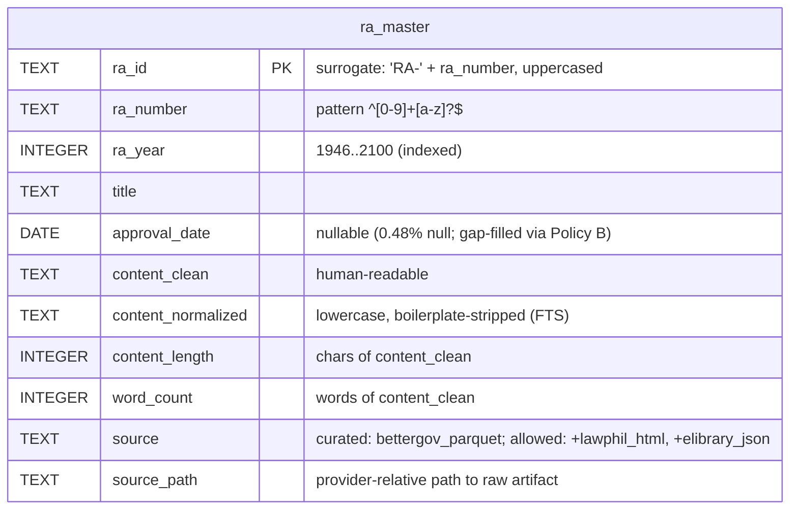

# ERD — `ra_master`

The curated layer is a **single denormalized table**. One row per Republic Act with all text in 
one place, no foreign keys needed.

## Entity-Relationship Diagram

## Constraints and Indexes

From `sql/schema.sql`, transcribed 1:1:

- **Primary key:** `ra_id`
- **Unique:** `ra_number_year_unique (ra_number, ra_year)` — composite.
  The pipeline dedupes on `ra_id` (derived from `ra_number` alone) before
  load, so only one row per RA ever reaches the database. In this table,
  the composite constraint is strictly weaker than the `ra_id` primary
  key — which, since `ra_id = "RA-" + ra_number.upper()`, already implies
  `ra_number` uniqueness — and therefore acts as a defensive ceiling at
  the database layer, not as the primary dedupe mechanism.

  The three intra-source collisions documented in `architecture.md` §9
  and `data_flow.md` §2 (RA-6426, RA-7663, RA-7688) arise because the
  BetterGov source files the same statute under two different year
  folders; the pipeline's `ra_id` dedupe keeps the first-seen row and
  drops the sibling. RA numbers themselves are not reused across years —
  they are assigned sequentially and once.
- **CHECK constraints (7):**
  - `ra_year_range` — `ra_year BETWEEN 1946 AND 2100`
  - `ra_id_shape` — `ra_id ~ '^RA-[0-9]+[A-Z]?$'`
  - `ra_number_shape` — `ra_number ~ '^[0-9]+[a-z]?$'`
  - `source_allowed` — `source IN ('bettergov_parquet', 'lawphil_html', 'elibrary_json')`
  - `word_count_nonneg` — `word_count >= 0`
  - `content_length_nonneg` — `content_length >= 0`
  - `source_path_nonempty` — `length(source_path) > 0`
- **Indexes (4 total):**
  - Implicit from PK: `ra_master_pkey` on `(ra_id)`
  - Implicit from UNIQUE: `ra_number_year_unique` on `(ra_number, ra_year)`
  - Explicit: `idx_ra_master_year` — B-tree on `(ra_year)`
  - Explicit: `idx_ra_master_content_fts` — GIN on `to_tsvector('english', content_normalized)`

The single table has **no foreign keys** — the curated layer is
denormalized by design.